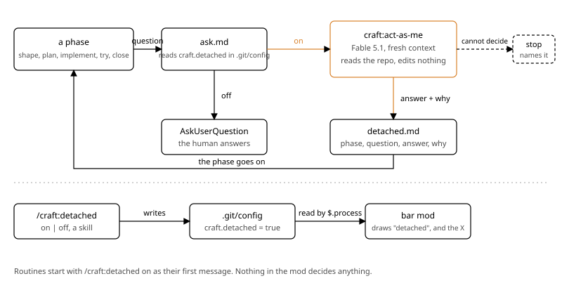

# Detached

## What

Detached mode lets craft carry a piece of work with nobody at the keyboard. While it is on, every question a phase would put to the human (shape, plan, implement, try and close, approvals and confirmations included) is answered instead by a new craft agent, `craft:act-as-me`, on Fable 5.1, in a fresh context, as an extremely pragmatic senior software engineer who takes nothing for granted. Each answer is written to `detached.md` in the work's folder with its phase, the question, the answer and why, so whoever left the work running reads in the morning what was decided in their name. It is for the human who leaves routines building work overnight and wants to be the bottleneck only where it pays: reading `detached.md` and reviewing the pull request. The bar says `detached` while the mode is on, and gets an X to hide itself without typing `/craft:bar off`.

## How it works

A question leaves a phase, `ask.md` reads one git flag, and the question goes either to the human or to `craft:act-as-me`, whose answer lands in `detached.md` before the phase goes on.

- New: `agents/act-as-me.md`, `model: fable`, tools `Read, Grep, Glob, Bash`, never edits. Its prompt is one line of identity, an extremely pragmatic senior software engineer who takes nothing for granted, and three duties: check in the code what the code can settle before answering; answer one option, or one of its own, with why in one or two lines; say `Cannot decide` with what is missing instead of inventing. One more paragraph keeps the idea the human gave settled. The caller hands it the phase, the work's folder and the question exactly as it would be asked (the options, the recommended answer first).
- `references/ask.md` (edited) names who decides: facts are the phase's job and decisions belong to whoever answers, the human, or `craft:act-as-me` when `git config --get craft.detached` prints `true`. Every question goes to that one, the ones `AskUserQuestion` would carry and the trivial yes or no that goes in plain text (`references/ask.md:7`). An approval or a confirmation is a question like any other: a change it asks for is made, then the draft is approved without asking again. The answer and its why are appended to `detached.md` in the work's folder (phase, question, answer, why, in order; the file is created with the folder). When the agent cannot decide, or does not start, the phase stops, names the question, and writes that too.
- Every line that hands a decision to the human is edited to hand it to whoever answers, as `ask.md` says: the try that leaves the machine (`skills/try/SKILL.md:14`), the commit with its branch and pull request (`skills/close/SKILL.md:26`) and the lesson file (`skills/close/SKILL.md:24`), the need nothing settles (`skills/implement/SKILL.md:32`), the worktree offer (`references/worktree.md:3`), shape's confirmation (`skills/shape/SKILL.md:22`), plan's approval (`skills/plan/SKILL.md:32`), and review's three handoffs: the clean draft (`references/review.md:7`), the uncertain verdict (`references/review.md:11`) and the wall (`references/review.md:13`). Shape and plan already interview as `ask.md` says (`skills/shape/SKILL.md:14`, `skills/plan/SKILL.md:20`). Lines that only describe the human (`references/work.md:5`, `skills/status/SKILL.md:18`, `references/how-it-looks.md:3`) stay.
- New: `skills/detached/SKILL.md`, `/craft:detached on|off` (bare toggles), `disable-model-invocation: false`: runs `git config --local craft.detached true`, or `--unset` for off (which exits 5 when the key is already gone, and that is off too), and answers one line. A routine starts with `/craft:detached on` as its first message, then its work.
- `hooks/register.ts` (edited) reads the flag with `$.process` (`git config --get craft.detached`) on every craft `command.run` (`hooks/register.ts:101`) and every main-loop `turn.complete` (`hooks/register.ts:123`); `hooks/bar.ts` (edited) keeps `isDetached` in the state and draws a `detached` piece after the phase. The bar draws nothing until a phase command or a craft agent runs (`hooks/bar.ts:124`), so `/craft:detached on` alone shows no bar.
- `hooks/register.ts` (edited): a `Button` closes the line, label `x`, `role: dismiss`, whose `onPress` sets the same hidden flag `/craft:bar off` sets and redraws.
- The mod adds nothing Claude reads. Detached itself needs no mod: the flag is in git and the skills read it.

## How it looks

[band](look/band.html)

## Decisions

- **A craft agent, not the harness advisor.** The advisor tool exists in a desktop session and in a local routine, and not in a cloud routine (probe on 2026-10-22, https://claude.ai/code/session_015v49Qz95CZHyvnUbJj3PFZ: not found). A plugin agent runs wherever craft runs, carries its own prompt and model, and can be graded by an eval like every other agent.
- **Named `act-as-me`.** It says what it does, and does not clash with the harness tool called `advisor`, which a desktop session also lists. The human chose it.
- **Fable 5.1.** The human's choice. It is the one place craft runs Fable (`agents/build.md:4` sonnet, `agents/evaluate.md:5` and `agents/review.md:5` opus), and it costs one Fable call per question.
- **No criteria file, one line of identity.** The agent is an extremely pragmatic senior software engineer who takes nothing for granted, and that plus its three duties, a line that keeps the given idea settled, and the caller line is the whole prompt. A longer prompt would lend it criteria, which is what the human does not want; their own criteria would have to live outside craft, which is bound for the plugin directory, and they chose not to have them at all.
- **The switch is `craft.detached` in the repo's local git config.** Per repository, outside the tree, never committed, no `.gitignore` line to add in every repo, and craft already requires a git repository (`references/work.md:7`). The mod's `$.store` was the alternative and it is one JSON per user, common to every repo. Shared by a repo's worktrees, which is what a work in a worktree wants.
- **The skill flips the flag, the mod only reads it.** `/craft:detached` works with mods off; nothing in the mod decides anything. `disable-model-invocation: false` on it and on `/craft:bar`, so a routine whose prompt asks for the mode in words can turn it on with the Skill tool (asked by the human while building; the shape first kept both at `true`).
- **Two modes, no override.** No rule in craft hands a decision to "the human" any more: every one that did now hands it to whoever answers, and `ask.md` says who that is in each mode. Detached mode is not an exception to a rule, it is the second mode of every rule. The human's own global rule on commits and pushes is theirs to word the same way, with no plugin named.
- **Every phase, every question.** Shape included, approvals included, the worktree offer included. The human's rule, stated twice. Close commits, pushes and opens the pull request when whoever answers says yes; the human reviews the pull request.
- **Stop when it cannot decide or does not start.** In a routine nobody answers a question, so stopping with the question named is the honest outcome, and it is in `detached.md` with the rest.
- **`detached.md` is the record.** Phase, question, answer, why, in order. Not `shape.md`'s Decisions: those are the work's, this file is the human's morning read, and it says who decided.
- **The bar says `detached`, and gets the X.** Both change `hooks/bar.ts` and `hooks/register.ts` and nothing else, so they are one slice: two slices never share a file (`references/slice.md:12`). The X reverses the craft bar's "no buttons" (`docs/craft/craft-bar/shape.md:31`) for one button the human asked for, which does what `/craft:bar off` does.
- **One eval per phase with the flag on.** Craft keeps evals for every phase skill (`b42f575`; `/craft:bar` has none); the detached path of each phase gets its own, graded on the trace: no `AskUserQuestion` call, at least one `craft:act-as-me` spawn, the entry in `detached.md`. Implement has none: its path was seen live in `try.md`, since the eval could not reach a question.

## Assumptions

- Tested on this machine, assumed in the desktop app and in a cloud routine: a craft agent whose frontmatter says `model: fable` starts and answers as Fable. Launched headless with this plugin, `craft:act-as-me` named `claude-fable-5-1` (`agents/act-as-me.md:5`), and in the live try it answered implement's and close's questions (`try.md`). On 2026-10-22 a cloud routine on Opus 5.5 launched an `Agent` with `model: "fable"` and it replied `claude-fable-5-1` (https://claude.ai/code/session_01YbA9XTg9rN5j1htx2PYreS). The desktop app and a cloud routine load the installed plugin, so they wait for 4.9.0 to be released; Claude confirms then. If wrong there, detached mode has no agent on that surface.
- Tested: craft's mod loads in a routine, local and cloud. On 2026-10-22 the human typed `/craft:bar`, `/craft:bar on` and `/craft:bar off` in a local routine's session (2.1.303) and in a cloud routine's session (2.1.308, https://claude.ai/code/session_01Csaqoz2QqSoqfpiTsFF4G8), and the mod answered each with its own line. Works at `hooks/register.ts:101`. If wrong, the bar shows no `detached` in routines; the mode itself does not need the mod.
- Tested in the terminal, assumed in the desktop app: `$.process` runs `git config --get craft.detached` from the mod. The live try drew `detached` in the bar of an interactive session (`hooks/register.ts:53`, `try/bar-detached.txt`). The desktop app loads the installed plugin until 4.9.0 is released. If wrong there, the mod reads the config with `$.fs`: `<root>/.git/config`, or, when `.git` is a file, the `config` inside the directory that the `commondir` file names, relative to the directory the `gitdir:` line points at (`../..` for a linked worktree, so the main `.git`). Claude confirms after the release.
- Tested in the terminal, assumed in the desktop app: a `Button` draws in the band above the prompt and a press raises its `onPress`. In the live try ctrl+x tab and Enter pressed the `x`, the bar left the next frame and the store kept `hidden` (`hooks/register.ts:153`, `try/bar-after-x.txt`). The desktop's native close control waits for 4.9.0; the human confirms it there. If wrong there, `/craft:bar off` stays.
- Tested: a routine whose first message is a craft command runs it as if the human had typed it. On 2026-10-22 a cloud routine whose whole prompt was `/craft:bar on` got `craft: The craft bar is on.` from the mod, in a session on 2.1.308 (https://claude.ai/code/session_014DrFuR3BnjgUNEpsE85Rs3). Headless sessions with nobody to answer called the `craft:detached` skill from a prompt in words (`try/words-on-trace.jsonl`); a cloud routine running the skill waits for 4.9.0. If wrong, the routine's prompt runs the git command itself.
- Assumed: `git config --local` in a linked worktree writes the repository's shared config, so one flag covers every worktree of a repo. The evaluate agent saw it on 2026-10-22 in a throwaway repo on git 2.51.1: the write from the linked worktree landed in the main `.git/config`, with and without `extensions.worktreeConfig`. Still assumed: that run was not in this repo and its folder will not last. If wrong, the flag is per worktree, which still works. Not run during implement or try; Claude confirms after the release.
